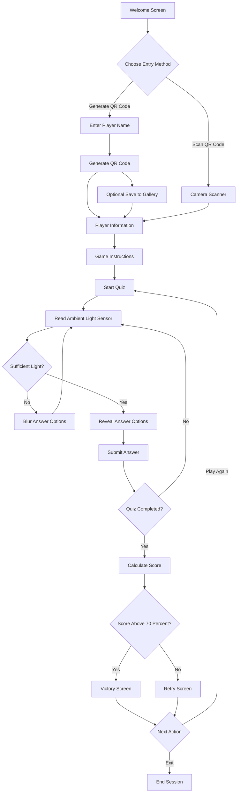
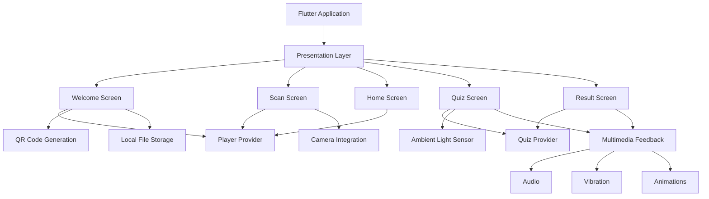
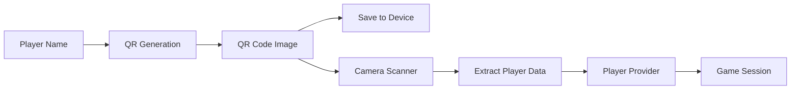
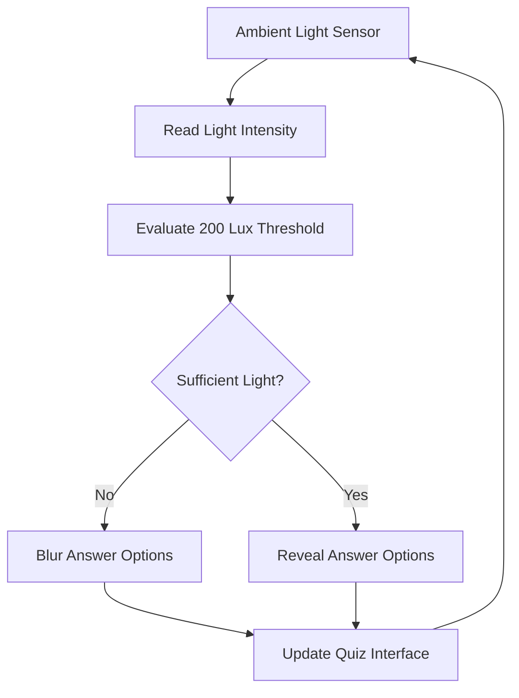

# Escape Museum – Interactive Flutter Mobile Application


An interactive mobile escape game developed with **Flutter and Dart**, combining QR code generation, real-time QR code scanning, ambient light sensor integration, interactive quizzes, and multimedia feedback.

Escape Museum enhances museum visits through gamification by connecting smartphone hardware capabilities with interactive digital gameplay.

The application demonstrates mobile software development, reactive state management, hardware integration, modular architecture, and sensor-driven user experience design.

---

## Table of Contents

- [Project Overview](#project-overview)
- [Key Features](#key-features)
- [Application Workflow](#application-workflow)
- [Technology Stack](#technology-stack)
- [Flutter Packages](#flutter-packages)
- [Application Architecture](#application-architecture)
- [Project Structure](#project-structure)
- [QR Code Integration](#qr-code-integration)
- [Ambient Light Sensor Integration](#ambient-light-sensor-integration)
- [Quiz and Scoring System](#quiz-and-scoring-system)
- [Installation and Setup](#installation-and-setup)
- [Running the Application](#running-the-application)
- [Building an Android APK](#building-an-android-apk)
- [Permissions and Hardware Requirements](#permissions-and-hardware-requirements)
- [Testing and Validation](#testing-and-validation)
- [Privacy and Security](#privacy-and-security)
- [Known Limitations](#known-limitations)
- [Future Improvements](#future-improvements)
- [Technical Skills Demonstrated](#technical-skills-demonstrated)
- [Acknowledgments](#acknowledgments)
- [License](#license)

---

## Project Overview

**Escape Museum** is an independently developed mobile application designed to provide an engaging and interactive museum experience through QR code technology, environmental sensors, and quiz-based gameplay.

Inspired by the exhibition *Le Meilleur du Terroir Belge*, the application explores how mobile technologies can enhance cultural discovery and visitor engagement.

Players generate or scan personalized QR codes, receive game instructions, complete a series of interactive questions, and receive feedback based on their performance.

A distinctive feature of the application is its integration with the smartphone's ambient light sensor. The visibility of quiz answers dynamically changes according to surrounding lighting conditions, creating a connection between the physical environment and digital gameplay.

### Project Objectives

- Develop an interactive mobile application using Flutter and Dart.
- Integrate smartphone hardware capabilities into application logic.
- Implement QR code generation and scanning.
- Process real-time environmental sensor data.
- Build reactive and dynamic user interfaces.
- Manage shared application state using Provider.
- Integrate audio, animations, and haptic feedback.
- Maintain a modular and organized application structure.

---

## Key Features

### QR Code Generation

- Generate personalized QR codes using player names.
- Render QR codes directly within the application.
- Capture generated QR codes as images.
- Save QR code images to the device gallery.
- Reuse previously generated QR codes.

### QR Code Scanning

- Real-time QR code scanning using the smartphone camera.
- Extract player information from scanned QR codes.
- Navigate to the game instructions after scanning.
- Support personalized game entry.

### Player Management

- Personalized player identification.
- Shared player information across application screens.
- Provider-based state management.
- Display game instructions before starting a session.

### Interactive Quiz System

- Five questions per game session.
- Dynamic question progression.
- Score tracking and calculation.
- Environment-dependent answer visibility.
- Victory and retry conditions.
- Replay and exit functionality.

### Ambient Light Sensor Integration

- Real-time ambient light measurements.
- Light intensity detection in lux.
- Dynamic blurring of answer options under low-light conditions.
- Automatic answer visibility changes based on environmental lighting.
- Sensor-driven graphical interface updates.

### Multimedia Feedback

- Background music.
- Audio feedback.
- Device vibration.
- Animated interface components.
- Lottie-based animations.
- Interactive victory and retry screens.

### User Interface

- Flutter-based mobile interface.
- Dedicated screens for each application stage.
- Custom typography using Google Fonts.
- Interactive navigation.
- Dynamic visual feedback.

---

## Application Workflow

The application follows a structured workflow from player identification to quiz completion and result evaluation.



### Application Screens

| Screen | Description |
|---|---|
| Welcome Screen | Entry point with QR generation and scanning options |
| Scan Screen | Camera-based QR code scanning |
| Home Screen | Player information and game instructions |
| Quiz Screen | Interactive questions and ambient light sensor integration |
| Result Screen | Score evaluation, animations, and replay options |

---

## Technology Stack

| Technology | Purpose |
|---|---|
| Flutter | Mobile application development and UI rendering |
| Dart | Core programming language |
| Provider | Reactive application state management |
| Android SDK | Android application runtime and hardware integration |
| QR Code Technology | Player identification |
| Device Camera | QR code recognition |
| Ambient Light Sensor | Environment-driven gameplay |
| Local File System | QR code image storage |
| Lottie | Animated visual feedback |
| Google Fonts | Custom application typography |

**Primary platform:** Android

The application is designed around Android mobile hardware capabilities. Compatibility with other platforms has not been independently verified.

---

## Flutter Packages

The application uses several Flutter packages to support state management, hardware integration, multimedia functionality, and graphical interface enhancements.

| Package | Responsibility |
|---|---|
| `provider` | Player information and quiz state management |
| `mobile_scanner` | Real-time QR code scanning using the camera |
| `qr_flutter` | QR code generation and rendering |
| `light` | Accessing ambient light sensor measurements |
| `screenshot` | Capturing generated QR codes as images |
| `permission_handler` | Managing device permissions |
| `path_provider` | Accessing local filesystem directories |
| `google_fonts` | Custom fonts and typography |
| `blur` | Dynamic answer blurring effects |
| `audioplayers` | Background music and audio playback |
| `vibration` | Device vibration feedback |
| `animate_do` | Widget and interface animations |
| `lottie` | Animated gameplay and result feedback |

All project dependencies and asset declarations are managed through the `pubspec.yaml` configuration file.

---

## Application Architecture

The project follows a modular Flutter architecture that separates presentation, application state, hardware interactions, and multimedia resources.



### Presentation Layer

Responsible for:

- Application screens and widgets.
- User interactions.
- Screen navigation.
- Graphical rendering.
- Dynamic answer visibility.
- Visual feedback.

### State Management Layer

The application uses Provider to manage shared state across different screens.

#### Player Provider

Responsible for:

- Player name management.
- Player identification.
- Sharing player information across application screens.

#### Quiz Provider

Responsible for:

- Quiz question management.
- Question progression.
- Current question tracking.
- Score calculation.
- Game state management.

### Hardware Integration

Responsible for accessing mobile device capabilities, including:

- Smartphone camera.
- Ambient light sensor.
- Local device storage.
- Device vibration.

### Multimedia Resources

Responsible for supporting:

- Background music.
- Audio feedback.
- Graphical assets.
- Interface animations.
- Lottie animations.

---

## Project Structure

The following structure highlights the primary application source files and resources.

```text
escape-museum-flutter/
│
├── lib/
│   ├── main.dart
│   │
│   ├── screens/
│   │   ├── welcome_screen.dart
│   │   ├── scan_screen.dart
│   │   ├── home_screen.dart
│   │   ├── quiz_screen.dart
│   │   └── result_screen.dart
│   │
│   └── providers/
│       ├── player_provider.dart
│       └── quiz_provider.dart
│
├── assets/
│   ├── images/
│   ├── audio/
│   └── animations/
│
├── pubspec.yaml
└── README.md
```

### Directory Responsibilities

| Directory or File | Responsibility |
|---|---|
| `lib/main.dart` | Application entry point and initialization |
| `lib/screens/` | Application views and user interactions |
| `lib/providers/` | Shared player and quiz state |
| `assets/images/` | Graphical resources and quiz images |
| `assets/audio/` | Background music and sound resources |
| `assets/animations/` | Animation resources |
| `pubspec.yaml` | Project dependencies and asset configuration |
| `README.md` | Project documentation |

---

## QR Code Integration

The application uses QR codes as a lightweight mechanism for player identification and game entry.

### QR Code Generation

1. The player enters a name.
2. The application converts the name into QR code data.
3. The QR code is generated using `qr_flutter`.
4. The player can capture the generated QR code as an image.
5. The image can be saved to the device.
6. The player proceeds to the game instructions.

### QR Code Scanning

1. The player selects the QR scanning option.
2. Camera permission is requested if necessary.
3. The device camera detects an existing QR code.
4. Encoded player information is extracted.
5. Player state is updated through Provider.
6. The application navigates to the player information screen.



QR codes are used for gameplay identification and are not intended to provide secure user authentication.

---

## Ambient Light Sensor Integration

One of the application's primary technical features is the integration of environmental sensor data into interactive gameplay.

The application accesses the smartphone's ambient light sensor through the `light` Flutter package.

Light intensity is measured in **lux**.

### Lighting Conditions

| Light Intensity | Application Behavior |
|---|---|
| Below 200 lux | Question remains visible, but answer options are blurred |
| Above 200 lux | Answer options become visible |
| Changing light conditions | The interface updates according to sensor readings |

The exact behavior at 200 lux depends on the comparison implemented in the source code.

### Sensor Processing Workflow



### Technical Highlights

This functionality demonstrates:

- Mobile hardware integration.
- Real-time sensor data processing.
- Reactive user interface development.
- Conditional widget rendering.
- Event-driven programming.
- Environment-aware application behavior.

Unlike a conventional quiz application, Escape Museum incorporates real-world environmental conditions directly into its gameplay mechanics.

---

## Quiz and Scoring System

Each game session contains five questions.

The application tracks question progression and player performance through the quiz state management system.

### Game Rules

- Each session contains five questions.
- Answer visibility depends on environmental lighting.
- Player answers contribute to the final score.
- A score above 70% is required to win.
- Players can restart the game or exit after completing a session.

### Scoring Example

Assuming equally weighted questions:

| Correct Answers | Score | Result |
|---:|---:|---|
| 0 out of 5 | 0% | Retry |
| 1 out of 5 | 20% | Retry |
| 2 out of 5 | 40% | Retry |
| 3 out of 5 | 60% | Retry |
| 4 out of 5 | 80% | Victory |
| 5 out of 5 | 100% | Victory |

### Result Screen

The result screen provides:

- Final score.
- Victory or retry feedback.
- Visual animations.
- Multimedia feedback.
- Play Again option.
- Exit option.

---

## Installation and Setup

### Prerequisites

Before running the application, ensure that the following tools are installed:

- Flutter SDK.
- Dart SDK, included with Flutter.
- Android SDK.
- Android Studio or Visual Studio Code.
- Git.
- A physical Android device with a camera and ambient light sensor.

Official installation resources:

- [Flutter Installation Guide](https://docs.flutter.dev/get-started/install)
- [Flutter Documentation](https://docs.flutter.dev/)
- [Android Studio](https://developer.android.com/studio)

### 1. Clone the Repository

Copy the repository HTTPS URL from the GitHub **Code** button and execute:

```bash
git clone <repository-url> escape-museum-flutter
cd escape-museum-flutter
```

Replace `<repository-url>` with the HTTPS URL of this GitHub repository.

Run the remaining commands from the directory containing `pubspec.yaml`.

### 2. Verify Flutter Installation

```bash
flutter doctor
```

Resolve any missing dependencies or Android SDK configuration issues reported by Flutter.

### 3. Install Project Dependencies

```bash
flutter pub get
```

This command installs the Flutter packages defined in `pubspec.yaml`.

### 4. Connect an Android Device

For the complete application experience, use a physical Android smartphone.

On the Android device:

1. Enable Developer Options.
2. Enable USB debugging.
3. Connect the smartphone to the computer using a USB cable.
4. Approve the USB debugging authorization request.

### 5. Verify Connected Devices

```bash
flutter devices
```

Ensure that the physical Android device appears in the list of available devices.

---

## Running the Application

From the Flutter project directory, execute:

```bash
flutter run
```

If multiple devices are connected, specify the target device:

```bash
flutter run -d <device_id>
```

Replace `<device_id>` with the identifier displayed by:

```bash
flutter devices
```

### Physical Device Recommendation

A physical Android device is strongly recommended because the application depends on:

- Real-world ambient light sensor measurements.
- Camera-based QR code scanning.
- Device vibration.
- Device storage and gallery interactions.

Android emulators may be useful for interface development and testing. However, hardware-dependent functionality may not behave as intended.

---

## Building an Android APK

To generate a release APK, execute:

```bash
flutter build apk --release
```

The generated APK is normally located at:

```text
build/app/outputs/flutter-apk/app-release.apk
```

The APK can be installed on a compatible Android device.

Successful release builds depend on the Android configuration, installed SDK components, project dependencies, and signing configuration.

---

## Permissions and Hardware Requirements

The application uses several smartphone capabilities to deliver its interactive experience.

| Capability | Purpose |
|---|---|
| Camera | QR code scanning |
| Local Storage / Gallery | Saving generated QR code images |
| Ambient Light Sensor | Sensor-based quiz interactions |
| Vibration | Haptic feedback |
| Audio Playback | Background music and sound effects |

Camera access and certain storage operations may require runtime permissions.

Storage permission requirements may vary depending on the Android version and the file-saving implementation.

The standard Android ambient light sensor generally does not require a separate runtime permission, but compatible sensor hardware must be available.

### Recommended Hardware

- Physical Android smartphone.
- Functional camera.
- Compatible ambient light sensor.
- Sufficient local storage.

---

## Testing and Validation

### Physical Device Testing

A physical Android device is recommended for validating:

- QR code generation and scanning.
- Camera permission handling.
- Ambient light sensor measurements.
- Dynamic answer visibility.
- Quiz progression.
- Score calculation.
- Audio playback.
- Device vibration.
- Image saving.
- Replay functionality.

### Emulator Testing

An Android emulator can be useful for testing:

- Application navigation.
- User interface layouts.
- Widget rendering.
- Quiz state management.
- Score calculation.
- Interface animations.

However, real-world sensor readings and camera functionality may not be accurately reproduced on all emulators.

### Manual Testing Checklist

- [ ] Application launches successfully.
- [ ] Player name can be entered.
- [ ] Personalized QR code is generated.
- [ ] QR code can be saved to the device.
- [ ] Existing QR code can be scanned.
- [ ] Player information is displayed correctly.
- [ ] Quiz starts successfully.
- [ ] Answers are blurred under low-light conditions.
- [ ] Answers become visible under sufficient lighting.
- [ ] All five questions are displayed.
- [ ] Final score is calculated correctly.
- [ ] Victory and retry conditions work correctly.
- [ ] Audio feedback operates correctly.
- [ ] Device vibration operates correctly.
- [ ] Replay and exit functionality work correctly.

### Static Code Analysis

Run Flutter's static analysis tools:

```bash
flutter analyze
```

### Automated Testing

Flutter supports automated unit, widget, and integration testing.

When automated tests are available, execute:

```bash
flutter test
```

---

## Privacy and Security

The application uses player names for personalized gameplay and QR code generation.

Important considerations:

- Generated QR codes may contain readable player information.
- QR codes should not contain passwords or sensitive personal information.
- Camera and storage access should be limited to their intended functionality.
- Generated QR code images should be handled responsibly.
- QR code identification should not be considered secure authentication.

Future improvements may include enhanced QR code validation, improved permission handling, and privacy-oriented data management.

---

## Known Limitations

- Complete functionality depends on compatible Android hardware.
- Ambient light sensor availability varies between devices.
- Emulator hardware support may be limited.
- Storage permissions may behave differently across Android versions.
- The quiz currently contains five questions per session.
- The ambient light threshold is fixed at 200 lux.
- QR code identification is not a secure authentication mechanism.
- Cross-platform compatibility has not been independently verified.

---

## Future Improvements

The following enhancements are proposed for future development.

### Hardware and Sensor Integration

- [ ] Detect ambient light sensor availability.
- [ ] Add fallback behavior for devices without compatible sensors.
- [ ] Improve sensor reading stability.
- [ ] Introduce configurable lighting thresholds.
- [ ] Improve camera and sensor lifecycle management.

### QR Code Enhancements

- [ ] Improve QR code input validation.
- [ ] Handle malformed QR codes.
- [ ] Introduce structured QR code payloads.
- [ ] Improve QR code sharing and export functionality.

### Gameplay Improvements

- [ ] Expand the question library.
- [ ] Introduce multiple difficulty levels.
- [ ] Randomize quiz questions.
- [ ] Add timed quiz challenges.
- [ ] Implement local score history.
- [ ] Introduce achievements and rewards.

### User Experience

- [ ] Improve application accessibility.
- [ ] Add multilingual support.
- [ ] Introduce an interactive onboarding tutorial.
- [ ] Add configurable audio settings.
- [ ] Improve permission-related error messages.
- [ ] Enhance responsive layouts.

### Software Quality

- [ ] Implement automated unit tests.
- [ ] Introduce widget and integration tests.
- [ ] Mock hardware sensor data for automated testing.
- [ ] Improve application error handling.
- [ ] Introduce GitHub Actions for continuous integration.
- [ ] Apply consistent formatting and static analysis.

### Deployment

- [ ] Verify compatibility across multiple Android versions.
- [ ] Evaluate iOS compatibility.
- [ ] Generate versioned Android releases.
- [ ] Publish downloadable APK files through GitHub Releases.

---

## Technical Skills Demonstrated

This project demonstrates practical software engineering and mobile application development capabilities.

### Mobile Application Development

- Flutter application development.
- Dart programming.
- Widget-based user interface design.
- Screen navigation.
- Android application development.
- Mobile hardware integration.

### State Management

- Provider-based state management.
- Shared application state.
- Reactive user interfaces.
- State-driven gameplay.
- Separation of presentation and application state.

### Hardware and Sensor Integration

- Camera integration.
- QR code generation and scanning.
- Ambient light sensor processing.
- Device vibration.
- Mobile permission management.
- Hardware-dependent application behavior.

### Software Engineering

- Modular application architecture.
- Separation of concerns.
- Event-driven programming.
- Conditional rendering.
- Dependency management.
- Application configuration.

### Multimedia and User Experience

- Audio playback.
- Animated interface components.
- Lottie animations.
- Custom typography.
- Interactive visual feedback.
- Gamification.
- Environment-aware user interactions.

### Mobile Data Handling

- QR code data encoding.
- QR code data extraction.
- Image capture.
- Local filesystem access.
- Player information management.

---

## Acknowledgments

Escape Museum is inspired by the exhibition *Le Meilleur du Terroir Belge* and explores how mobile technologies can enhance cultural discovery through interactive experiences.

The application was independently developed using technologies and resources maintained by the open-source development community.

- [Flutter](https://flutter.dev/)
- [Dart](https://dart.dev/)
- [Provider](https://pub.dev/packages/provider)
- [Mobile Scanner](https://pub.dev/packages/mobile_scanner)
- [QR Flutter](https://pub.dev/packages/qr_flutter)
- [Lottie](https://pub.dev/packages/lottie)
- [Google Fonts](https://fonts.google.com/)

---

## License

No open-source license is granted through this README.

Use, modification, and redistribution of the application remain subject to the applicable rights and permissions.

Third-party packages, graphical assets, audio resources, and animations may be subject to their respective licenses.

---

<p align="center">
  <strong>Escape Museum</strong>
</p>

<p align="center">
  Mobile Development · Flutter · Dart · QR Technology · Sensor Integration
</p>
